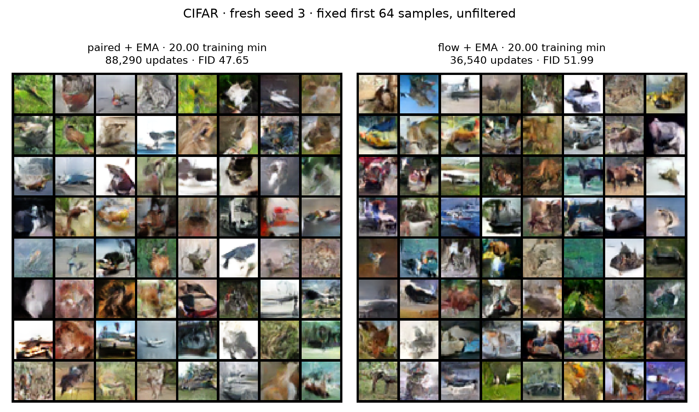
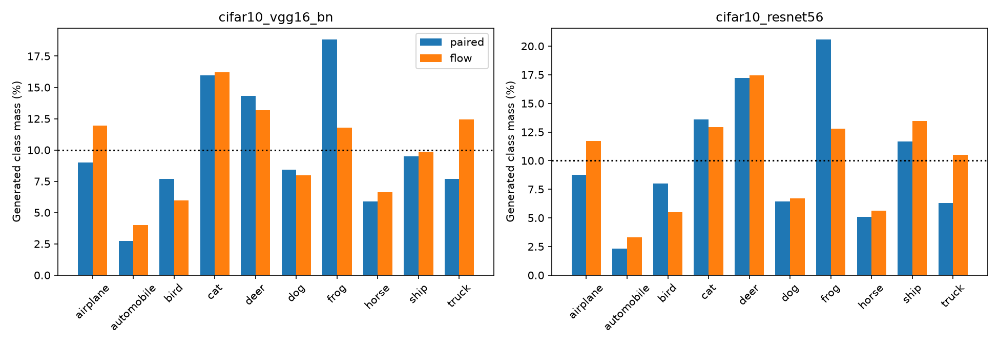

# CIFAR under a 20-minute training budget (#40)

Two previously selected recipes, fresh training seed 3, one final EMA checkpoint each. No architecture/optimizer sweep and no selection on these outputs. Best-known recipes are not proven optimal for this budget.

At the fixed 20-minute training endpoint, paired GAN has lower FID/KID and higher feature recall; flow has higher precision and better class balance under both classifiers. This reverses the longer-training FID ranking for this single seed. It does not establish an optimal recipe or a robust cross-seed ranking.

| Recipe | Updates | Train FID ↓ | Test FID ↓ | KID ↓ | Precision ↑ | Recall ↑ | VGG TV ↓ | ResNet TV ↓ |
|---|---:|---:|---:|---:|---:|---:|---:|---:|
| paired + EMA | 88,290 | 47.86 | 47.65 | 0.03279 | 0.584 | 0.344 | 0.1909 | 0.2308 |
| flow + EMA | 36,540 | 52.24 | 51.99 | 0.04236 | 0.645 | 0.269 | 0.1556 | 0.1885 |

Single-seed outcomes: no training-seed uncertainty estimate. Both use the same evaluation sample count and frozen references/classifiers; noise 99574 is new. Test-reference metrics are descriptive given shared research history. Class TV does not measure within-class diversity.

The first 64 unfiltered samples from both methods include ambiguous or malformed objects. Visual inspection does not establish a categorical quality winner. Class-mass plots show paired overrepresenting frogs (about 19–21%) and both methods underrepresenting automobiles (about 2–4%).

## Recipes and budget

Original paired GAN: width 64, latent 128, Adam 2e-4/betas(.5,.999), EMA .999. At 50k updates reset both Adam optimizers, sampling RNG, and EMA to raw G, reproducing the selected experiment 37 branch schedule. Flow: width 32 velocity net, Adam 2e-4/betas(.9,.999), 500-step warmup,EMA .999. Unchanged BCE/velocity-MSE, batch 128, uniform unconditional sampling; no deficit or labels.

Both stop when accumulated synchronized training time reaches 1,200 seconds (ten-update checking granularity, at most 5 seconds permitted overshoot). This time includes forward/backward/optimizers/EMA and training-loop overhead; excludes evaluation, setup and checkpoint/volume I/O. This is a training-time comparison, not equal provider billing.

| Recipe | Training min | Evaluation min | Worker-body min | Batched inference ms/image | G parameters | D parameters | Real-image draws |
|---|---:|---:|---:|---:|---:|---:|---:|
| paired | 20.00 | 0.57 | 31.84 | 0.0131 | 1,183,619 | 666,049 | 22,602,240 |
| flow | 20.00 | 2.10 | 27.00 | 8.9790 | 1,170,083 | 0 | 4,677,120 |

Total measured training 40.00 GPU-minutes, evaluation 2.67, small verification 0.09. Worker-body time 58.84 GPU-minutes includes I/O and benchmark; do not add it to training/evaluation again. Container setup/data loading remain unmeasured.

Inference: A10, batch 128, two warmups and median of five synchronized timed batches, reported per image. This is batched throughput, not batch-one latency. Flow uses 64 midpoint steps / 128 velocity calls versus one G call for GAN.

Why these recipes: prior paired EMA train FID 49.28 effectively tied independent scoring 49.25, with better class balance. Cross-attention cost more without a clear overall win. Flow EMA was repeatably strong; lower LR did not independently help. No newly enlarged networks or expensive searches were added. Prior studies used more compute, so this result cannot establish their equal-budget ceiling.

Cost caveat: checkpoint/volume I/O kept GPUs allocated beyond their training caps. The 58.84 worker-body GPU-minutes are substantially above the 40.00 measured training minutes; future cost caps should include this overhead. No extra training, retries or sweeps were added.

Checks: two CUDA exact model/Adam/RNG split resumes and parity against original loops; paired reset parity; four local tests; two full first-batch generation replays; source/data/classifier/reference identity; frozen specs and timing checks.

[Frozen protocol](protocol.json) · [Metrics and budget](summary.json) · [Verification](verification_report.json)
